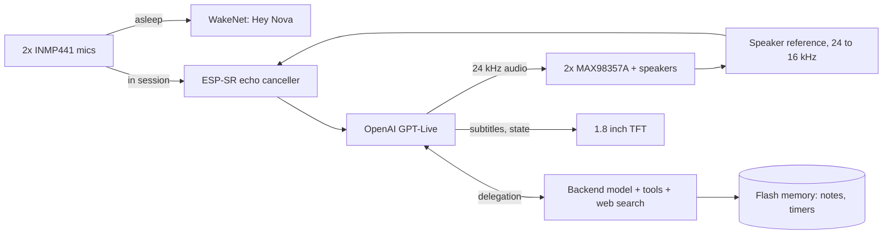

# Nova V2

**English** · [Türkçe](README.tr.md)

A standalone AI voice agent in a hand-bent copper frame. One ESP32-S3, no computer in the loop: it wakes on "Hey Nova", talks to OpenAI's real-time voice model directly over Wi-Fi, cancels its own echo so you can interrupt it, and remembers things between conversations.


## The story

I wanted an AI agent that lives on my desk. The idea was simple. Building it wasn't.

**V1 (Jarvis)**, on the left, was built in summer 2026: a small copper cage, one microphone, a tiny OLED and a single speaker. The ESP32 only carried audio; a Python script on my laptop did the thinking and talked to Gemini Live. It worked, but it was an accessory, not a device. Along the way it taught me a few things the hard way: OLEDs dying to noise, a noisy amplifier supply, speaker crackle fixed with series resistors, and a battery that has to stay isolated from a bare metal frame. It now sits retired on the shelf with its battery unplugged.

**Nova V2**, on the right, started as an upgrade and ended up as a different project: new hardware, a new architecture, and no computer anywhere in the chain.

## Highlights

- **The frame is the ground.** A hexagonal cage of 2 mm bare copper, bent by hand. The whole cage is the circuit's GND. No PCB, no enclosure: every part is wired and soldered directly onto the frame.
- **No PC, no relay server.** The ESP32-S3 opens a TLS WebSocket straight to OpenAI GPT-Live (`gpt-live-1`), a model that listens and speaks at the same time.
- **Interruptible without an audio codec.** Echo cancellation runs on the chip using a software copy of what the speakers are playing, so you can talk over Nova and she stops.
- **On-device wake word.** "Hey Nova" is detected locally with Espressif WakeNet. Audio leaves the device only after it wakes.
- **Second brain built in.** A personal profile and a persistent memory that Nova reads at the start of every conversation, plus tools for timers, alarms, settings and notes.
- **Does things while idle.** Hourly weather, a news digest three times a day, and an automatic pass that pulls lasting facts out of the last conversation.
- **Built like a product.** Its own anti-aliased UI at 20 FPS, a web panel at `http://nova.local`, wireless updates with automatic rollback, and a desktop test suite.

## How it works



While asleep, only the wake word engine listens. On "Hey Nova" the engine is unloaded, the cloud session opens, and microphone audio goes through the echo canceller to the model. GPT-Live doesn't call tools itself; it hands search and device actions to a backend model, which calls the tools the firmware exposes.

## Hardware

| Part | Notes |
|---|---|
| ESP32-S3 N16R8 | 16 MB flash, 8 MB octal PSRAM |
| 2x INMP441 | I2S MEMS mics on a shared bus (one L/R pin to GND, the other to 3V3), hung from the lower front corners |
| 2x MAX98357A | I2S class-D amps, both fed the same mono signal; GAIN and SD left floating |
| 2x 5 cm 8 Ω 5 W speakers | One on each side face of the cage |
| 1.8" ST7735 TFT | 160x128, SPI |
| 2x 18650 in parallel | TP4056 USB-C charger, MT3608 boost to 5 V |
| 47k/47k divider | Battery voltage on an ADC pin |

**Construction notes**

- The copper is scraped clean before every joint. Thin enamelled wire is used for the signal runs to the mics.
- Battery negative is kept isolated from the cage. The cage joins ground at the boost converter output (`VOUT-`).
- The I2S lines have series resistors at the ESP32 side (a lesson from V1's speaker crackle).

**Pin map** (`firmware/nova_live/config.h`)

| Function | GPIO |
|---|---|
| Right amp BCLK / LRC / DIN | 42 / 2 / 41 |
| Left amp BCLK / LRC / DIN | 10 / 11 / 9 |
| Mic SCK / WS / SD | 12 / 13 / 14 |
| TFT BLK / CS / DC / RST / MOSI / SCK | 4 / 5 / 6 / 7 / 15 / 16 |
| Battery ADC | 3 |
| BOOT button / RGB LED | 0 / 48 |

The hand-drawn schematic is in `docs/` (not fully up to date; `config.h` is the source of truth).

## Firmware

`firmware/nova_live/` is the current firmware (v2.8.x), built with the Arduino IDE.

| File | Role |
|---|---|
| `nova_live.ino` | Wi-Fi, button, commands, background tasks |
| `link.cpp` | Conversation state machine: sleep, connect, listen, think, speak |
| `proto.h`, `gptlive.cpp` | Provider interface and the GPT-Live protocol |
| `wsclient.cpp` | WebSocket client with large-message buffers in PSRAM |
| `audio.cpp`, `loudness.h`, `resample.h` | I2S, playback, limiter, resampling, echo cancellation, mic self-tests |
| `wake.cpp`, `heynova_model.c` | "Hey Nova" (WakeNet10, model embedded in the firmware) |
| `araclar.cpp`, `hafiza.cpp` | Device tools; notes and timers in flash |
| `notcikar.cpp` | Post-session fact extraction |
| `hava.cpp`, `gundem.cpp`, `agistek.cpp` | Weather, news digest, small HTTPS client |
| `ekran.cpp`, `ui.cpp` | Display renderer and UI task |
| `netlog.cpp` | `nova.local` panel, OTA, crash reports, safe mode |
| `kisilik.h` | Nova's character (shared) |
| `kisisel.example.h` | Template for your own profile (`kisisel.h` stays private) |

## Engineering notes

### Picking the voice model

Before settling on one, three live voice models were run side by side on the same board through a common provider interface:

| | Gemini 3.8 Live | GPT Realtime 2.1 | GPT-Live 1 |
|---|---|---|---|
| Time to first audio | ~1.0–1.2 s | ~1.2–3.5 s | ~0.8–1.5 s |
| Short Turkish phrases transcribed correctly | often wrong | often wrong | yes |
| Turn taking | silence-based | semantic VAD | listens and speaks at once |

GPT-Live won on latency, transcription and how natural its Turkish sounded, and being full-duplex makes it the best fit for interruption. The other two drivers implement the same interface and are kept in `firmware/arsiv/saglayicilar/`.

### Echo cancellation without a codec

Boards built for voice usually have an audio codec that feeds the speaker signal back as a reference. Nova has two standalone I2S amps, so the reference is made in software:

1. The playback task runs the model's audio through a high-pass filter, a gain stage and a look-ahead limiter with a −3 dBFS ceiling.
2. The final output is downsampled from 24 kHz to 16 kHz (96-tap Kaiser FIR) and written to a 4-second ring buffer in PSRAM.
3. A calibration command plays 3 s of white noise and finds the speaker-to-mic delay by cross-correlation. On this cage it's **81.6 ms**.
4. The mic signal is attenuated by 12 dB before the canceller. Without that headroom up to 5.7 % of samples clipped at high volume, and clipped echo can't be cancelled. With it, clipping went to 0 %.
5. ESP-SR's frequency-domain AEC runs in PSRAM (~9.7 ms per 32 ms frame), followed by a gate that only passes sound clearly above the measured residual echo.

Suppression is 31–40 dB with the white-noise test and typically 12–17 dB on real speech at 80 % volume. That's enough for barge-in in practice.

### Fitting TLS, the wake word and AEC into internal RAM

TLS (mbedTLS) on this core only allocates from internal RAM, and so do parts of WakeNet and the AEC. Early builds failed TLS handshakes with "Memory allocation failed" once the largest free internal block dropped to 30 KB.

- All large buffers (audio, WebSocket, UI, text) and the mic queue were moved to PSRAM, freeing about 66 KB of internal RAM.
- The wake word engine only exists while Nova is asleep. On wake, and before any background HTTPS request, it is torn down so TLS and the AEC get that memory.
- The 476 KB wake model is compiled into the firmware and loaded from memory, so no separate model partition is needed. The partition table gives each app slot 6 MB.

### Memory and the second brain

- `kisilik.h` defines who Nova is. `kisisel.h` (not in the repo) describes her owner. Both go into the system prompt of every session, along with date, weather, the news digest, active timers and stored notes.
- Notes are saved by tools (`remember`, `forget`) with three rules: save when asked, save useful lasting facts on her own, ask first for anything sensitive.
- Voice models sometimes say "noted" without calling the tool. So 2 seconds after a session ends, the device sends the transcript to the Responses API with a strict JSON schema and applies whatever lasting facts come back.
- Storage is two 32 KB slots on the raw flash partition, written alternately with a sequence number and CRC. Flash writes stall the cache, so they only happen after 3 s of idle time and never during a conversation.

### Debugging the microphones

Wiring everything by hand onto a live ground frame means hardware faults look like software bugs.

- A boot self-test found that the mic WS and SCK wires were swapped relative to the soldering notes.
- Later both mics started dropping out at random, often while typing on the keyboard or while the speakers played. Supply, ground and clock voltages all looked fine on a multimeter.
- To separate firmware from wiring, an internal loopback test was added: the ESP32 routes its own WS clock into the data input through the GPIO matrix. It passed every time, even during dropouts, which cleared the firmware.
- A live monitor (`c`) drives the onboard LED green/yellow/red per mic. With it running, flexing the joints changed the state: a cold solder joint. After resoldering, 600 of 600 checks were clean.

### UI, web panel and updates

- The renderer draws into a 160x128 RGB565 buffer in PSRAM with anti-aliased rings and Turkish fonts, then sends only the changed spans over SPI. About 20 FPS during a session.
- `http://nova.local` shows the live log, device state, notes and timers, and accepts firmware uploads.
- A new firmware stays "pending" until it has run on Wi-Fi for 20 s; if it crashes first, the bootloader rolls back. Three crashes in a row boot into a safe mode with only Wi-Fi, the panel and OTA. The last ~2 KB of log survives a reset.

## Testing

The connection logic, tools, memory, echo maths and renderer build and run on Linux (or WSL) against an in-process fake GPT-Live server:

```bash
cd firmware/tests/nova_live_masaustu
./build.sh ../../nova_live
./t_wake    # session flow: wake, talk, barge-in, goodbye, tools
./t_arac    # memory, timers, tools, weather and news parsing
./t_echo    # delay search, resampler, gate
./t_ekran   # renderer, with AddressSanitizer
```

Each should end with `SONUC: GECTI`. Changes are also checked by deliberately breaking the code and confirming a test fails.

## Build and flash

Arduino IDE, esp32 core **3.3.12 or newer**.

| Tools setting | Value |
|---|---|
| Board | ESP32S3 Dev Module |
| PSRAM | OPI PSRAM |
| Flash Size | 16MB |
| Partition Scheme | Custom (uses `partitions.csv` in the sketch folder) |
| Flash Mode | QIO 80MHz |

Libraries: Adafruit GFX, Adafruit ST7735 and ST7789. ArduinoJson is bundled. The build stops with a clear error if PSRAM or the partition scheme is wrong.

1. Copy `secrets.example.h` to `secrets.h` and fill in Wi-Fi, `OPENAI_API_KEY` and `OTA_PASS` (8+ characters).
2. Optionally copy `kisisel.example.h` to `kisisel.h` and describe yourself.
3. Flash over USB the first time (the partition table only changes over USB). After that, update from `http://nova.local` or the IDE's network port.
4. Run `a` once to measure the echo delay, then `e` to turn on barge-in.

## Commands

Serial (115200) or the text box on `nova.local`:

| Key | Action |
|---|---|
| `w` / `x` / `b` | wake / close session / act like the BOOT button |
| `n` | wake word: off, normal, sensitive, very sensitive |
| `a` / `e` | echo calibration / barge-in on-off |
| `o` / `O` | next / previous voice |
| `H` | list notes and timers (`/unut 3`, `/iptal 2` on the panel) |
| `u` | usage and cost counter |
| `+` / `-` | volume |
| `t` `l` `r` / `g` | test tone both, left, right / loudness test |
| `m` / `c` | mic self-test / live mic monitor |
| `R` / `?` | reboot / help |

Saying "görüşürüz" or "oturumu kapat" ends a session; so does a short goodbye from Nova.

## Known limitations

- GPT-Live is billed per connected minute (about $0.05/min, silence included). Sessions close after a few seconds of silence to keep this down.
- Interruption waits for the server to transcribe your words, so there's a short delay before Nova stops.
- The "Hey Nova" model is Espressif's English model trained on synthetic voices. It works, but you have to say it fairly clearly.
- Echo suppression drops at very high volume, where the amp and speakers stop being linear.
- The firmware and comments are in Turkish.

## Repository layout

| Path | Contents |
|---|---|
| `firmware/nova_live/` | Current firmware |
| `firmware/arsiv/saglayicilar/` | Gemini Live and GPT Realtime drivers, last multi-provider build |
| `firmware/tests/nova_live_masaustu/` | Desktop tests |
| `firmware/nova_tools/` | Web panel source and font generator |
| `docs/` | Photos and schematic |

## Credits

- [Espressif ESP-SR](https://github.com/espressif/esp-sr) for WakeNet and AEC, including the "Hey Nova" model
- [RIO](https://github.com/mk14ray/RIO-XIAO-ESP32-S3-Gemini-Live-Voice-Assistant), which showed codec-less AEC on an ESP32-S3 was possible
- Adafruit GFX and ST7735 libraries, ArduinoJson, Chakra Petch (OFL), Open-Meteo

## License

TBD
