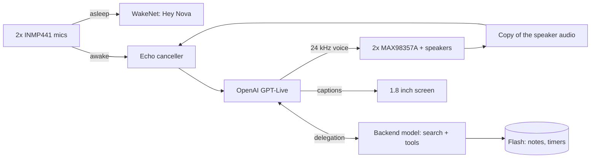

# Nova V2

**English** · [Türkçe](README.tr.md)

**A voice AI that lives in a copper cage on my desk.** One ESP32-S3, no laptop, no server, no PCB. Say "Hey Nova" and she wakes up, talks to OpenAI's real-time voice model, lets you cut her off mid-sentence, and remembers you the next day.


## What she can do

- 🎙️ **Wakes on "Hey Nova"**, detected on the chip itself. Nothing leaves the device until she's awake.
- ⚡ **Talks in real time.** The ESP32-S3 opens a WebSocket straight to OpenAI GPT-Live, a model that listens and speaks at the same time.
- ✋ **Can be interrupted.** She cancels her own echo in software, so you can talk over her and she stops. No audio codec involved.
- 🧠 **Remembers.** Notes, preferences, people, ongoing projects. A small second brain that she reads at the start of every conversation.
- 🛠️ **Gets things done.** Web search, timers, alarms, volume, brightness, settings, all by voice.
- ☀️ **Stays informed.** Hourly weather and a news digest three times a day, so she already knows what's going on when you ask.
- 🟠 **Has a face.** A copper-themed UI on a 1.8" screen at 20 FPS, plus a web panel at `http://nova.local` with live logs and wireless updates.

## How it started

I wanted an AI that sits on my desk. Sounded simple. It wasn't.

**V1 (Jarvis)**, on the left, was built in summer 2026: a small copper cage, one mic, a tiny OLED and a single speaker. The ESP32 only moved audio around. The real thinking happened in a Python script on my laptop. It worked, but it was a laptop accessory, not a device. It also taught me a few lessons the hard way: OLEDs die from noise, amp supplies hum, speaker crackle goes away with series resistors, and a battery should never touch a bare metal frame. It's retired on a shelf now, battery out.

**Nova V2**, on the right, was supposed to be an upgrade. It became a whole new project: new hardware, new architecture, and no computer anywhere in the chain.

The frame is 2 mm bare copper, bent by hand into a hexagonal cage, and **the whole cage is the circuit's ground**. There's no PCB and no enclosure. Every part is soldered straight onto the frame. Somewhere along the way it stopped being just a circuit and became a small piece of cyberpunk art.

## How it works



While Nova sleeps, only the wake word engine listens. On "Hey Nova" it steps aside, a cloud session opens, and the mic audio goes through the echo canceller to the model. GPT-Live doesn't call tools by itself: when you ask for a search or a timer, it hands the job to a backend model, which calls the tools the firmware exposes.

## The hard parts

### Echo cancellation without a codec

To let you interrupt her, Nova has to hear you over her own voice. Boards made for voice assistants have an audio codec that hands the speaker signal back as a reference. Nova only has two standalone I2S amps, so I build that reference in software:

1. Everything she says goes through a high-pass filter, a gain stage and a look-ahead limiter (−3 dBFS ceiling).
2. That final signal is downsampled from 24 to 16 kHz and kept in a 4-second ring buffer in PSRAM.
3. A calibration command plays 3 seconds of white noise and finds the speaker-to-mic delay by cross-correlation. On this cage it's **81.6 ms**.
4. The mic is turned down 12 dB before the canceller. Without that headroom, up to 5.7% of samples clipped at high volume, and clipped echo can't be removed. With it: 0%.
5. Espressif's AEC runs in PSRAM (about 9.7 ms per 32 ms frame). After it, an adaptive gate only passes sound that's clearly above the leftover echo. When the gate opens, it also sends the few hundred milliseconds it held back, so the start of your sentence isn't lost.

On white noise this removes 31–40 dB of echo. On real speech at 80% volume it's usually 12–17 dB. Enough to interrupt her in a normal voice.

### Squeezing TLS, a wake word and an AEC into internal RAM

On this core, TLS only allocates from internal RAM, and so do parts of the wake word engine and the AEC. Early builds kept dying in the TLS handshake with "Memory allocation failed" once the largest free block dropped to 30 KB.

- Every big buffer (audio, WebSocket, UI, text) and the mic queue moved to PSRAM, which freed about 66 KB of internal RAM.
- The wake word engine only exists while Nova sleeps. On wake, and before any background HTTPS request, it's torn down so TLS and the AEC get that memory.
- The 476 KB wake model is compiled into the firmware and loaded from memory, so no separate model partition is needed.

### Picking the voice

I didn't want to choose a model on paper, so I ran three live voice models side by side on the same board, behind one interface:

| | Gemini 3.8 Live | GPT Realtime 2.1 | GPT-Live 1 |
|---|---|---|---|
| Time to first audio | ~1.0–1.2 s | ~1.2–3.5 s | ~0.8–1.5 s |
| Short Turkish phrases transcribed right | often wrong | often wrong | yes |
| Turn taking | waits for silence | semantic VAD | listens and talks at once |

GPT-Live won on speed, transcription and how natural it sounds in Turkish. And because it's full duplex, it's the best fit for interruptions.

### A second brain that doesn't forget

- `kisilik.h` says who Nova is, `kisisel.h` (never committed) says who her owner is. Both go into the system prompt of every session, together with the date, weather, news digest, active timers and saved notes.
- She saves notes through tools with three rules: save when asked, save useful lasting facts on her own, ask first if it's sensitive.
- Voice models sometimes say "noted" without actually calling the tool. So two seconds after a session ends, the device sends the transcript to the Responses API with a strict JSON schema and saves whatever lasting facts come back.
- Notes live in two 32 KB flash slots written in turns, with a sequence number and a CRC. Flash writes stall the cache, so they never happen mid-conversation.

### The cold solder joint that looked like a software bug

When everything is hand-soldered onto a live ground frame, hardware faults dress up as software bugs.

- The boot self-test caught that the mic WS and SCK wires were swapped compared to my own soldering notes.
- Later both mics started dropping out at random, usually while I was typing or the speakers were playing. Supply, ground and clock all looked fine on the multimeter.
- To split firmware from wiring, I added a loopback test: the ESP32 routes its own WS clock into the data input through the GPIO matrix. It passed every single time, even during dropouts. Not the firmware, then.
- A live monitor (`c`) lights the onboard LED green, yellow or red per mic. With it running, wiggling the joints changed the color: a cold joint. After resoldering, 600 out of 600 checks came back clean.

### Built like a product

- The renderer draws anti-aliased rings and Turkish-capable fonts into a 160x128 buffer in PSRAM and only sends the changed parts over SPI. About 20 FPS during a conversation.
- New firmware stays "pending" until it has run on Wi-Fi for 20 seconds. If it crashes before that, the bootloader rolls back on its own. Three crashes in a row boot into a safe mode with just Wi-Fi, the web panel and OTA.
- The last ~2 KB of log survives a reset, so a crash always leaves a note behind.

## Hardware

| Part | Notes |
|---|---|
| ESP32-S3 N16R8 | 16 MB flash, 8 MB octal PSRAM |
| 2x INMP441 | I2S MEMS mics on a shared bus (one L/R pin to GND, the other to 3V3), hanging from the lower front corners |
| 2x MAX98357A | I2S class-D amps playing the same mono signal; GAIN and SD left floating |
| 2x 5 cm 8 Ω 5 W speakers | One on each side of the cage |
| 1.8" ST7735 TFT | 160x128, SPI |
| 2x 18650 in parallel | TP4056 USB-C charger, MT3608 boost to 5 V |
| 47k/47k divider | Battery voltage on an ADC pin |

A few build notes:

- I scrape the copper clean before every joint. Signal runs to the mics are thin enamelled wire.
- Battery negative never touches the cage. The cage joins ground at the boost converter output (`VOUT-`).
- The I2S lines have series resistors on the ESP32 side, a lesson from V1's crackling speaker.

<details>
<summary>Pin map</summary>

| Function | GPIO |
|---|---|
| Right amp BCLK / LRC / DIN | 42 / 2 / 41 |
| Left amp BCLK / LRC / DIN | 10 / 11 / 9 |
| Mic SCK / WS / SD | 12 / 13 / 14 |
| TFT BLK / CS / DC / RST / MOSI / SCK | 4 / 5 / 6 / 7 / 15 / 16 |
| Battery ADC | 3 |
| BOOT button / RGB LED | 0 / 48 |

The schematic is hand-drawn and not fully up to date. When in doubt, `firmware/nova_live/config.h` wins.

</details>

## Build your own

Arduino IDE with the esp32 core **3.3.12 or newer**.

| Tools setting | Value |
|---|---|
| Board | ESP32S3 Dev Module |
| PSRAM | OPI PSRAM |
| Flash Size | 16MB |
| Partition Scheme | Custom (uses `partitions.csv` in the sketch folder) |
| Flash Mode | QIO 80MHz |

Libraries: Adafruit GFX and Adafruit ST7735 and ST7789. ArduinoJson is already included.

1. Copy `secrets.example.h` to `secrets.h` and fill in your Wi-Fi, `OPENAI_API_KEY` and an `OTA_PASS` (8+ characters).
2. Give her a personality in `kisilik.h`. It's empty on purpose. If you want her to know you, copy `kisisel.example.h` to `kisisel.h` and fill it in.
3. Flash over USB the first time. After that you can update from `http://nova.local` or the IDE's network port.
4. Run `a` once to measure the echo delay, then `e` to turn on interruptions.

The screen is in English by default. Set `UI_ENGLISH` to `0` in `config.h` for Turkish.

<details>
<summary>Commands (Serial at 115200 or the text box on nova.local)</summary>

| Key | Action |
|---|---|
| `w` / `x` / `b` | wake / close the session / same as the BOOT button |
| `n` | wake word: off, normal, sensitive, very sensitive |
| `a` / `e` | echo calibration / interruptions on-off |
| `o` / `O` | next / previous voice |
| `H` | list notes and timers |
| `u` | usage and cost counter |
| `+` / `-` | volume |
| `t` `l` `r` / `g` | test tone on both, left, right / loudness test |
| `m` / `c` | mic self-test / live mic monitor |
| `R` / `?` | reboot / help |

Saying "bye bye" or "görüşürüz" ends the session.

</details>

<details>
<summary>What's in the firmware</summary>

| File | What it does |
|---|---|
| `nova_live.ino` | Wi-Fi, button, commands, background tasks |
| `link.cpp` | The conversation flow: sleep, connect, listen, think, speak |
| `proto.h`, `gptlive.cpp` | Provider interface and the GPT-Live protocol |
| `wsclient.cpp` | WebSocket client with big buffers in PSRAM |
| `audio.cpp`, `echo_math.h`, `loudness.h`, `resample.h` | I2S, playback, limiter, resampling, echo cancellation, mic self-tests |
| `wake.cpp`, `heynova_model.c` | "Hey Nova" (WakeNet10, model compiled in) |
| `araclar.cpp`, `hafiza.cpp`, `notcikar.cpp` | Device tools, memory, post-session note extraction |
| `hava.cpp`, `gundem.cpp`, `agistek.cpp` | Weather, news digest, a small HTTPS client |
| `ekran.cpp`, `ui.cpp` | Screen renderer and UI task |
| `netlog.cpp` | `nova.local` panel, OTA, crash reports, safe mode |

</details>

## Tests

The conversation logic, tools, memory, echo math and screen renderer build and run on Linux (or WSL) against a fake GPT-Live server:

```bash
cd firmware/tests/nova_live_masaustu
bash build.sh ../../nova_live
./t_wake && ./t_arac && ./t_echo && ./t_ekran
```

Each one should end with `SONUC: GECTI` ("result: passed"). For every change I also break the code on purpose and make sure a test catches it.

## Known limits

- GPT-Live is billed per connected minute (about $0.05/min, silence included), so sessions close on their own after a short silence.
- Interrupting needs the server to transcribe what you said, so there's a short delay before she stops.
- The "Hey Nova" model is Espressif's English model trained on synthetic voices. It works, but you need to say it clearly.
- At very high volume the amps and speakers stop being linear and echo cancellation gets worse.
- Code comments and logs are in Turkish.

## Credits

- [Espressif ESP-SR](https://github.com/espressif/esp-sr) for WakeNet, the AEC and the "Hey Nova" model
- [RIO](https://github.com/mk14ray/RIO-XIAO-ESP32-S3-Gemini-Live-Voice-Assistant), which showed me codec-less echo cancellation on an ESP32-S3 was doable
- Adafruit GFX and ST7735 libraries, ArduinoJson, Chakra Petch font (OFL), Open-Meteo

## License

MIT, see [LICENSE](LICENSE). Third-party parts keep their own licenses.
