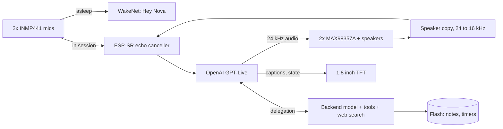

# Nova V2

**English** · [Türkçe](README.tr.md)

An AI voice assistant that lives in a hand-bent copper cage on my desk. One ESP32-S3, no laptop, no server. Say "Hey Nova" and it wakes up, talks straight to OpenAI's real-time voice model over Wi-Fi, lets you cut it off mid-sentence, and remembers you between conversations.


## How it started

I wanted an AI agent that sits on my desk. Sounded simple. It wasn't.

**V1 (Jarvis)**, on the left, came first in summer 2026: a small copper cage, one mic, a tiny OLED and one speaker. The ESP32 only moved audio around. The actual thinking happened in a Python script on my laptop that talked to Gemini Live. It worked, but it was a laptop accessory, not a device. It also taught me a few things the hard way: OLEDs die from noise, amp supplies hum, speaker crackle goes away with series resistors, and a battery has no business touching a bare metal frame. It's retired on a shelf now, battery out.

**Nova V2**, on the right, was supposed to be an upgrade. It turned into a different project: new hardware, new architecture, and no computer anywhere in the chain.

## Highlights

- **The frame is the ground.** 2 mm bare copper, bent by hand into a hexagonal cage, and the whole cage is the circuit's GND. No PCB, no enclosure. Every part is soldered straight onto the frame.
- **Nothing in between.** The ESP32-S3 opens a TLS WebSocket directly to OpenAI GPT-Live (`gpt-live-1`), a model that listens and talks at the same time.
- **You can interrupt it, without an audio codec.** Echo cancellation runs on the chip, using a software copy of whatever the speakers are playing. Talk over Nova and she stops.
- **Wake word on the device.** "Hey Nova" is detected locally with Espressif WakeNet. No audio leaves the device until it wakes up.
- **A second brain.** A personal profile and a long-term memory Nova reads at the start of every conversation, plus tools for timers, alarms, settings and notes.
- **Busy even when idle.** Weather every hour, a news digest three times a day, and an automatic pass that pulls lasting facts out of the last conversation.
- **Built like a product.** Its own anti-aliased UI at 20 FPS, a web panel at `http://nova.local`, wireless updates that roll back on their own if something breaks, and a desktop test suite.

## How it works



While Nova sleeps, only the wake word engine is listening. On "Hey Nova" the engine is unloaded, the cloud session opens, and the mic audio goes through the echo canceller to the model. GPT-Live doesn't call tools itself. It hands searches and device actions to a backend model, and that model calls the tools the firmware exposes.

## Hardware

| Part | Notes |
|---|---|
| ESP32-S3 N16R8 | 16 MB flash, 8 MB octal PSRAM |
| 2x INMP441 | I2S MEMS mics on a shared bus (one L/R pin to GND, the other to 3V3), hanging from the lower front corners |
| 2x MAX98357A | I2S class-D amps, both playing the same mono signal; GAIN and SD left floating |
| 2x 5 cm 8 Ω 5 W speakers | One on each side of the cage |
| 1.8" ST7735 TFT | 160x128, SPI |
| 2x 18650 in parallel | TP4056 USB-C charger, MT3608 boost to 5 V |
| 47k/47k divider | Battery voltage on an ADC pin |

**Build notes**

- I scrape the copper clean before every joint. The signal runs to the mics are thin enamelled wire.
- Battery negative never touches the cage. The cage joins ground at the boost converter output (`VOUT-`).
- The I2S lines have series resistors on the ESP32 side. That one's a lesson from V1's crackling speaker.

**Pin map** (`firmware/nova_live/config.h`)

| Function | GPIO |
|---|---|
| Right amp BCLK / LRC / DIN | 42 / 2 / 41 |
| Left amp BCLK / LRC / DIN | 10 / 11 / 9 |
| Mic SCK / WS / SD | 12 / 13 / 14 |
| TFT BLK / CS / DC / RST / MOSI / SCK | 4 / 5 / 6 / 7 / 15 / 16 |
| Battery ADC | 3 |
| BOOT button / RGB LED | 0 / 48 |

The schematic above is hand-drawn and not fully up to date. When in doubt, `config.h` wins.

## Firmware

`firmware/nova_live/` is the current firmware (v2.9.0). It builds with the Arduino IDE.

| File | What it does |
|---|---|
| `nova_live.ino` | Wi-Fi, button, commands, background tasks |
| `link.cpp` | The conversation flow: sleep, connect, listen, think, speak |
| `proto.h`, `gptlive.cpp` | Provider interface and the GPT-Live protocol |
| `wsclient.cpp` | WebSocket client, big message buffers in PSRAM |
| `audio.cpp`, `loudness.h`, `resample.h` | I2S, playback, limiter, resampling, echo cancellation, mic self-tests |
| `wake.cpp`, `heynova_model.c` | "Hey Nova" (WakeNet10, model compiled into the firmware) |
| `araclar.cpp`, `hafiza.cpp` | Device tools; notes and timers in flash |
| `notcikar.cpp` | Pulls lasting facts out of a finished conversation |
| `hava.cpp`, `gundem.cpp`, `agistek.cpp` | Weather, news digest, small HTTPS client |
| `ekran.cpp`, `ui.cpp` | Display renderer and UI task |
| `netlog.cpp` | `nova.local` panel, OTA, crash reports, safe mode |
| `kisilik.h` | Nova's character. Empty here on purpose, write your own |
| `kisisel.example.h` | Template for your own profile (`kisisel.h` never goes into the repo) |

## Engineering notes

### Picking the voice model

I didn't want to pick a model on paper, so I ran three live voice models side by side on the same board, behind one provider interface:

| | Gemini 3.8 Live | GPT Realtime 2.1 | GPT-Live 1 |
|---|---|---|---|
| Time to first audio | ~1.0–1.2 s | ~1.2–3.5 s | ~0.8–1.5 s |
| Short Turkish phrases transcribed right | often wrong | often wrong | yes |
| Turn taking | waits for silence | semantic VAD | listens and talks at once |

GPT-Live won on speed, transcription and how natural its Turkish sounded. Being full duplex also makes it the best fit for interrupting.

### Echo cancellation without a codec

Boards made for voice usually have an audio codec that hands the speaker signal back as a reference. Nova just has two standalone I2S amps, so the reference has to be built in software:

1. The playback task runs the model's audio through a high-pass filter, a gain stage and a look-ahead limiter with a −3 dBFS ceiling.
2. The final output is downsampled from 24 to 16 kHz (96-tap Kaiser FIR) and written to a 4-second ring buffer in PSRAM.
3. A calibration command plays 3 s of white noise and finds the speaker-to-mic delay by cross-correlation. On this cage it's **81.6 ms**.
4. The mic signal is turned down 12 dB before the canceller. Without that headroom up to 5.7% of samples clipped at high volume, and clipped echo can't be cancelled. With it, clipping dropped to 0%.
5. ESP-SR's frequency-domain AEC runs in PSRAM (~9.7 ms per 32 ms frame). After it, a gate only lets through sound that's clearly above the measured leftover echo. When the gate opens, the last few hundred ms it held back are sent too, so the start of your sentence isn't lost.

Suppression is 31–40 dB on the white noise test and usually 12–17 dB on real speech at 80% volume. In practice that's enough to interrupt her.

### Fitting TLS, the wake word and AEC into internal RAM

On this core TLS (mbedTLS) only allocates from internal RAM, and so do parts of WakeNet and the AEC. Early builds failed the TLS handshake with "Memory allocation failed" as soon as the largest free internal block dropped to 30 KB.

- Every big buffer (audio, WebSocket, UI, text) and the mic queue moved to PSRAM. That freed about 66 KB of internal RAM.
- The wake word engine only exists while Nova sleeps. On wake, and before any background HTTPS request, it's torn down so TLS and the AEC get that memory.
- The 476 KB wake model is compiled into the firmware and loaded from memory, so there's no separate model partition. The partition table gives each app slot 6 MB.

### Memory, a.k.a. the second brain

- `kisilik.h` says who Nova is, `kisisel.h` (not in the repo) says who her owner is. Both go into the system prompt of every session, together with the date, weather, news digest, active timers and saved notes.
- Notes are saved through tools (`remember`, `forget`) with three rules: save when asked, save useful lasting facts on your own, ask first if it's sensitive.
- Voice models sometimes say "noted" without actually calling the tool. So 2 seconds after a session ends, the device sends the transcript to the Responses API with a strict JSON schema and saves whatever lasting facts come back.
- Storage is two 32 KB slots on a raw flash partition, written in turns with a sequence number and a CRC. Flash writes stall the cache, so they only happen after 3 s of idle and never mid-conversation.

### Chasing a microphone fault

When you hand-solder everything onto a live ground frame, hardware faults start looking like software bugs.

- The boot self-test caught that the mic WS and SCK wires were swapped compared to my soldering notes.
- Later both mics started dropping out at random, mostly while I was typing or the speakers were playing. Supply, ground and clock all looked fine on the multimeter.
- To split firmware from wiring I added a loopback test: the ESP32 routes its own WS clock into the data input through the GPIO matrix. It passed every single time, even during dropouts. So, not the firmware.
- A live monitor (`c`) turns the onboard LED green, yellow or red per mic. With it running, wiggling the joints changed the color: a cold solder joint. After resoldering, 600 out of 600 checks came back clean.

### UI, web panel and updates

- The renderer draws into a 160x128 RGB565 buffer in PSRAM with anti-aliased rings and Turkish fonts, then only sends the changed spans over SPI. About 20 FPS during a session.
- `http://nova.local` shows the live log, device state, notes and timers, and takes firmware uploads.
- A new firmware stays "pending" until it has run on Wi-Fi for 20 s. If it crashes before that, the bootloader rolls back. Three crashes in a row boot into a safe mode with only Wi-Fi, the panel and OTA. The last ~2 KB of log survives a reset.

## Testing

The connection logic, tools, memory, echo math and renderer build and run on Linux (or WSL) against a fake GPT-Live server that runs in the same process:

```bash
cd firmware/tests/nova_live_masaustu
./build.sh ../../nova_live
./t_wake    # session flow: wake, talk, barge-in, goodbye, tools
./t_arac    # memory, timers, tools, weather and news parsing
./t_echo    # delay search, resampler, gate
./t_ekran   # renderer, with AddressSanitizer
```

Each one should end with `SONUC: GECTI` ("result: passed"). For every change I also break the code on purpose and make sure a test catches it.

## Build and flash

Arduino IDE, esp32 core **3.3.12 or newer**.

| Tools setting | Value |
|---|---|
| Board | ESP32S3 Dev Module |
| PSRAM | OPI PSRAM |
| Flash Size | 16MB |
| Partition Scheme | Custom (uses `partitions.csv` in the sketch folder) |
| Flash Mode | QIO 80MHz |

Libraries: Adafruit GFX, Adafruit ST7735 and ST7789. ArduinoJson is already in the folder. If PSRAM or the partition scheme is wrong, the build stops with a clear error.

1. Copy `secrets.example.h` to `secrets.h` and fill in Wi-Fi, `OPENAI_API_KEY` and `OTA_PASS` (at least 8 characters).
2. Write a character into `kisilik.h`. If you want Nova to know you, copy `kisisel.example.h` to `kisisel.h` and fill it in.
3. Flash over USB the first time (the partition table only changes over USB). After that you can update from `http://nova.local` or the IDE's network port.
4. Run `a` once to measure the echo delay, then `e` to turn on barge-in.

The screen is in English by default. Set `UI_ENGLISH` to `0` in `config.h` for Turkish.

## Commands

Over serial (115200) or the text box on `nova.local`:

| Key | Action |
|---|---|
| `w` / `x` / `b` | wake / close the session / same as the BOOT button |
| `n` | wake word: off, normal, sensitive, very sensitive |
| `a` / `e` | echo calibration / barge-in on-off |
| `o` / `O` | next / previous voice |
| `H` | list notes and timers (`/unut 3`, `/iptal 2` on the panel) |
| `u` | usage and cost counter |
| `+` / `-` | volume |
| `t` `l` `r` / `g` | test tone on both, left, right / loudness test |
| `m` / `c` | mic self-test / live mic monitor |
| `R` / `?` | reboot / help |

Saying "görüşürüz" ("see you") or "oturumu kapat" ("close the session") ends the session. So does a short goodbye from Nova.

## Known limits

- GPT-Live is billed per connected minute (about $0.05/min, silence included). To keep that down, a session closes on its own after a short silence.
- Interrupting waits for the server to transcribe what you said, so there's a short delay before Nova stops.
- The "Hey Nova" model is Espressif's English model, trained on synthetic voices. It works, but you need to say it fairly clearly.
- At very high volume the amps and speakers stop being linear and echo suppression drops.
- The code, comments and logs are in Turkish. Only the screen is in English.

## Repository layout

| Path | Contents |
|---|---|
| `firmware/nova_live/` | Current firmware |
| `firmware/tests/nova_live_masaustu/` | Desktop tests |
| `firmware/nova_tools/` | Web panel source and font generator |
| `docs/` | Photo and schematic |

## Credits

- [Espressif ESP-SR](https://github.com/espressif/esp-sr) for WakeNet, the AEC and the "Hey Nova" model
- [RIO](https://github.com/mk14ray/RIO-XIAO-ESP32-S3-Gemini-Live-Voice-Assistant), which showed me codec-less AEC on an ESP32-S3 was doable
- Adafruit GFX and ST7735 libraries, ArduinoJson, Chakra Petch (OFL), Open-Meteo

## License

MIT, see [LICENSE](LICENSE). Third-party parts keep their own licenses.
