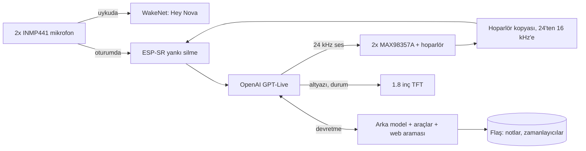

# Nova V2

[English](README.md) · **Türkçe**

Masamda, elle büktüğüm bakır bir kafesin içinde yaşayan yapay zekâ ses asistanı. Tek bir ESP32-S3, ne laptop var ne sunucu. "Hey Nova" deyince uyanıyor, Wi-Fi'dan doğrudan OpenAI'ın gerçek zamanlı ses modeliyle konuşuyor, lafını kesebiliyorsun ve konuşmalar arasında seni hatırlıyor.


## Nasıl başladı

Masamda duran bir yapay zekâ ajanı istedim. Kâğıt üstünde basitti, yaparken hiç değildi.

Soldaki **V1 (Jarvis)** 2026 yazında yapıldı: küçük bir bakır kafes, tek mikrofon, minik bir OLED ve tek hoparlör. ESP32 sadece sesi taşıyordu, asıl düşünme işini laptopumdaki bir Python betiği Gemini Live'la konuşarak yapıyordu. Çalışıyordu ama cihaz değil, laptopun aksesuarıydı. Bana birkaç şeyi de zor yoldan öğretti: OLED'ler parazitten ölüyor, amfi beslemesi uğulduyor, hoparlör cızırtısı seri dirençle geçiyor ve pilin çıplak metal kafese değmemesi lazım. Şimdi rafta emekli, pili sökülü.

Sağdaki **Nova V2** bir yükseltme olacaktı, bambaşka bir projeye döndü: yeni donanım, yeni mimari ve zincirin hiçbir yerinde bilgisayar yok.

## Öne çıkanlar

- **Kafesin kendisi toprak.** 2 mm çıplak bakırı elle büküp altıgen bir kafes yaptım, kafesin tamamı devrenin GND'si. Ne baskılı devre var ne kutu, her parça doğrudan kafese lehimli.
- **Arada kimse yok.** ESP32-S3, OpenAI GPT-Live'a (`gpt-live-1`) doğrudan şifreli bir WebSocket açıyor. Bu model aynı anda hem dinleyip hem konuşabiliyor.
- **Ses kodeği olmadan lafını kesebiliyorsun.** Yankı silme çipin üstünde çalışıyor, hoparlörde ne çalıyorsa yazılımdaki kopyasını kullanıyor. Nova konuşurken araya girersen susuyor.
- **Uyandırma kelimesi cihazda.** "Hey Nova"yı Espressif WakeNet yerelde yakalıyor. Uyanana kadar cihazdan dışarı tek bir ses bile çıkmıyor.
- **İkinci beyin.** Her konuşmanın başında okuduğu kişisel bir profil ve kalıcı bir hafıza, yanında zamanlayıcı, alarm, ayar ve not araçları.
- **Boşta da iş görüyor.** Saatte bir hava durumu, günde üç kez gündem özeti ve son konuşmadan kalıcı bilgileri kendi kendine ayıklama.
- **Ürün gibi.** 20 FPS'de çizilen kendi arayüzü, `http://nova.local` paneli, bir şey bozulursa kendiliğinden eski sürüme dönen kablosuz güncelleme ve masaüstünde koşan testler.

## Nasıl çalışıyor



Nova uyurken yalnızca uyandırma motoru dinliyor. "Hey Nova" denince motor bellekten kalkıyor, bulut oturumu açılıyor ve mikrofondaki ses yankı silmeden geçip modele gidiyor. GPT-Live araçları kendisi çağırmıyor. Aramayı ve cihaz işlerini bir arka modele devrediyor, araçları da o çağırıyor.

## Donanım

| Parça | Not |
|---|---|
| ESP32-S3 N16R8 | 16 MB flaş, 8 MB PSRAM |
| 2x INMP441 | Ortak I2S hattında (birinin L/R ayağı GND'de, diğerininki 3V3'te), kafesin ön alt köşelerinden sarkıyor |
| 2x MAX98357A | I2S amfi, ikisi de aynı mono sesi çalıyor; GAIN ve SD boşta |
| 2x 5 cm 8 Ω 5 W hoparlör | Kafesin iki yanında |
| 1.8" ST7735 TFT | 160x128, SPI |
| 2x 18650 paralel | TP4056 USB-C şarj, MT3608 ile 5 V'a yükseltme |
| 47k/47k bölücü | Pil gerilimini ADC'ye veriyor |

**Yapım notları**

- Her lehimden önce bakırı kazıyıp temizliyorum. Mikrofonlara giden sinyal hatları ince emaye tel.
- Pilin eksisi kafese hiç değmiyor. Kafes toprağa yükselticinin çıkışında (`VOUT-`) bağlanıyor.
- I2S hatlarında ESP32 tarafında seri direnç var. Bunu da V1'in cızırdayan hoparlöründen öğrendim.

**Pinler** (`firmware/nova_live/config.h`)

| İş | GPIO |
|---|---|
| Sağ amfi BCLK / LRC / DIN | 42 / 2 / 41 |
| Sol amfi BCLK / LRC / DIN | 10 / 11 / 9 |
| Mikrofon SCK / WS / SD | 12 / 13 / 14 |
| TFT BLK / CS / DC / RST / MOSI / SCK | 4 / 5 / 6 / 7 / 15 / 16 |
| Pil ADC | 3 |
| BOOT düğmesi / RGB LED | 0 / 48 |

Yukarıdaki şema elle çizildi ve tam güncel değil. Şüphede kalırsan `config.h`'ye bak.

## Firmware

Güncel firmware `firmware/nova_live/` klasöründe (v2.9.0), Arduino IDE ile derleniyor.

| Dosya | Ne yapıyor |
|---|---|
| `nova_live.ino` | Wi-Fi, düğme, komutlar, arka plan görevleri |
| `link.cpp` | Konuşmanın akışı: uyku, bağlanma, dinleme, düşünme, konuşma |
| `proto.h`, `gptlive.cpp` | Sağlayıcı arayüzü ve GPT-Live protokolü |
| `wsclient.cpp` | Büyük mesajları PSRAM'de tutan WebSocket istemcisi |
| `audio.cpp`, `loudness.h`, `resample.h` | I2S, çalma, sınırlayıcı, örnekleme dönüşümü, yankı silme, mikrofon testleri |
| `wake.cpp`, `heynova_model.c` | "Hey Nova" (WakeNet10, model firmware'in içinde) |
| `araclar.cpp`, `hafiza.cpp` | Cihaz araçları; notlar ve zamanlayıcılar flaşta |
| `notcikar.cpp` | Biten konuşmadan kalıcı bilgileri çıkarıyor |
| `hava.cpp`, `gundem.cpp`, `agistek.cpp` | Hava durumu, gündem özeti, küçük HTTPS istemcisi |
| `ekran.cpp`, `ui.cpp` | Ekran çizimi ve arayüz görevi |
| `netlog.cpp` | `nova.local` paneli, OTA, çökme raporu, güvenli kip |
| `kisilik.h` | Nova'nın karakteri. Burada bilerek boş, kendininkini yaz |
| `kisisel.example.h` | Kendi profilin için şablon (`kisisel.h` repoya hiç girmiyor) |

## Mühendislik notları

### Ses modelini seçmek

Kâğıt üstünden model seçmek istemedim. Üç canlı ses modelini tek bir sağlayıcı arayüzünün arkasında, aynı kartta yan yana denedim:

| | Gemini 3.8 Live | GPT Realtime 2.1 | GPT-Live 1 |
|---|---|---|---|
| İlk sese kadar | ~1,0–1,2 sn | ~1,2–3,5 sn | ~0,8–1,5 sn |
| Kısa Türkçe sözleri doğru yazıya dökme | sık hata | sık hata | evet |
| Söz sırası | sessizliği bekliyor | anlama bakıyor (semantic VAD) | aynı anda dinleyip konuşuyor |

GPT-Live hızda, yazıya dökmede ve Türkçesinin doğallığında öne geçti. Aynı anda dinleyip konuşabildiği için araya girmeye de en uygunu o.

### Kodeksiz yankı silme

Sesli asistan için yapılmış kartlarda genelde hoparlör sinyalini geri veren bir ses kodeği olur. Nova'da sadece iki ayrı I2S amfi var, o yüzden bu referansı yazılımda üretmek gerekti:

1. Çalma görevi modelden gelen sesi yüksek geçiren bir süzgeçten, kazançtan ve tavanı −3 dBFS olan, ileriye bakan bir sınırlayıcıdan geçiriyor.
2. Hoparlöre giden son ses 24 kHz'ten 16 kHz'e indiriliyor (96 katsayılı Kaiser FIR) ve PSRAM'de 4 saniyelik bir halkaya yazılıyor.
3. Bir ölçüm komutu 3 saniye beyaz gürültü çalıyor ve hoparlörden mikrofona gecikmeyi çapraz ilintiyle buluyor. Bu kafeste **81,6 ms**.
4. Mikrofon sesi yankı silmeye girmeden 12 dB kısılıyor. Bu pay yokken yüksek seste örneklerin %5,7'si kırpılıyordu, kırpılmış yankı da silinmiyor. Payla birlikte kırpılma %0'a indi.
5. ESP-SR'nin frekans tabanlı AEC'si PSRAM'de çalışıyor (32 ms'lik çerçeve başına ~9,7 ms). Arkasındaki kapı yalnızca ölçülen artık yankının belirgin üstündeki sesi geçiriyor. Kapı açılınca o ana kadar tuttuğu son birkaç yüz ms'yi de yolluyor, cümlenin başı kaybolmuyor.

Bastırma beyaz gürültüde 31–40 dB, %80 seste gerçek konuşmada genelde 12–17 dB. Pratikte lafını kesmeye yetiyor.

### TLS, uyandırma ve AEC'yi iç RAM'e sığdırmak

Bu çekirdekte TLS (mbedTLS) sadece iç RAM'den yer alıyor, WakeNet'in ve AEC'nin bir kısmı da öyle. İlk sürümlerde en büyük boş iç RAM bloğu 30 KB'a düşer düşmez TLS el sıkışması "Memory allocation failed" diye patlıyordu.

- Büyük tamponların hepsini (ses, WebSocket, arayüz, yazılar) ve mikrofon kuyruğunu PSRAM'e taşıdım, yaklaşık 66 KB iç RAM boşaldı.
- Uyandırma motoru sadece Nova uyurken var. Uyanınca ve arka plandaki her HTTPS isteğinden önce kaldırılıyor, yeri TLS'e ve AEC'ye kalıyor.
- 476 KB'lık uyandırma modeli firmware'in içine gömülü ve bellekten yükleniyor, ayrı bir model bölümüne gerek yok. Bölüm tablosu her yazılım yuvasına 6 MB veriyor.

### Hafıza, yani ikinci beyin

- `kisilik.h` Nova'nın kim olduğunu, `kisisel.h` (repoda yok) sahibinin kim olduğunu anlatıyor. İkisi de her oturumun sistem talimatına tarih, hava, gündem, kurulu zamanlayıcılar ve kayıtlı notlarla birlikte giriyor.
- Notlar araçlarla (`remember`, `forget`) kaydediliyor ve üç kural var: istenince kaydet, kalıcı ve işe yarar bir şey öğrenince kendin kaydet, hassassa önce sor.
- Ses modelleri bazen aracı hiç çağırmadan "not aldım" diyor. Bu yüzden oturum kapandıktan 2 saniye sonra cihaz konuşma dökümünü katı bir JSON şemasıyla Responses API'ye yolluyor, dönen kalıcı bilgileri hafızaya yazıyor.
- Kayıt, ham bir flaş bölümünde sırayla yazılan iki 32 KB'lık yuvada, sıra numarası ve CRC ile tutuluyor. Flaşa yazmak önbelleği durdurduğu için yazma sadece 3 saniye boşta kaldıktan sonra yapılıyor, konuşmanın ortasında asla.

### Mikrofon arızasının peşinde

Her şeyi canlı bir toprak kafesine elle lehimleyince donanım arızaları yazılım hatası kılığına giriyor.

- Açılış testi, mikrofonun WS ve SCK tellerinin lehim notlarımın tersine bağlandığını yakaladı.
- Sonra iki mikrofon birden rastgele kesilmeye başladı, çoğunlukla ben klavyede yazarken ya da hoparlör çalarken. Multimetrede besleme, toprak ve saat gayet normal görünüyordu.
- Yazılımı donanımdan ayırmak için bir iç döngü testi ekledim: ESP32 kendi WS saatini GPIO matrisi üzerinden veri girişine veriyor. Kesintilerin ortasında bile her seferinde geçti. Demek ki yazılım değil.
- Canlı izleme (`c`) karttaki LED'i her mikrofon için yeşil, sarı ya da kırmızı yakıyor. O açıkken lehimleri oynatınca renk değişti: soğuk lehim. Yeniden lehimledikten sonra 600 kontrolün 600'ü temiz geldi.

### Arayüz, panel ve güncelleme

- Ekran, PSRAM'deki 160x128'lik bir tampona yumuşak kenarlı halkalar ve Türkçe yazı tipleriyle çiziliyor, SPI'dan sadece değişen kısımlar gidiyor. Oturumda yaklaşık 20 FPS.
- `http://nova.local` canlı kaydı, cihazın durumunu, notları ve zamanlayıcıları gösteriyor, yazılım yüklemeyi de kabul ediyor.
- Yeni yazılım Wi-Fi'da 20 saniye sorunsuz çalışana kadar "deneme"de kalıyor. Ondan önce çökerse önyükleyici eskisine dönüyor. Üst üste üç çökmede sadece Wi-Fi, panel ve OTA ile açılan güvenli kip devreye giriyor. Son ~2 KB kayıt yeniden başlatmada silinmiyor.

## Testler

Bağlantı mantığı, araçlar, hafıza, yankı hesapları ve ekran çizimi Linux'ta (ya da WSL'de) derlenip aynı süreçte çalışan sahte bir GPT-Live sunucusuna karşı koşuyor:

```bash
cd firmware/tests/nova_live_masaustu
./build.sh ../../nova_live
./t_wake    # oturum akışı: uyanma, konuşma, araya girme, veda, araçlar
./t_arac    # hafıza, zamanlayıcılar, araçlar, hava ve gündem ayrıştırma
./t_echo    # gecikme arama, örnekleme dönüşümü, kapı
./t_ekran   # ekran çizimi, AddressSanitizer ile
```

Hepsi `SONUC: GECTI` ile bitmeli. Her değişiklikte kodu bilerek bozup testin yakaladığını da kontrol ediyorum.

## Kurulum

Arduino IDE, esp32 çekirdeği **3.3.12 ya da yenisi**.

| Tools ayarı | Değer |
|---|---|
| Board | ESP32S3 Dev Module |
| PSRAM | OPI PSRAM |
| Flash Size | 16MB |
| Partition Scheme | Custom (klasördeki `partitions.csv` kullanılır) |
| Flash Mode | QIO 80MHz |

Kütüphaneler: Adafruit GFX, Adafruit ST7735 and ST7789. ArduinoJson zaten klasörde. PSRAM ya da bölüm ayarı yanlışsa derleme net bir hatayla duruyor.

1. `secrets.example.h`'yi `secrets.h` adıyla kopyala, Wi-Fi, `OPENAI_API_KEY` ve `OTA_PASS` (en az 8 karakter) alanlarını doldur.
2. `kisilik.h`'ye bir karakter yaz. Nova'nın seni tanımasını istiyorsan `kisisel.example.h`'yi `kisisel.h` olarak kopyalayıp doldur.
3. İlk yüklemeyi USB'den yap (bölüm tablosu sadece USB'den değişiyor). Sonrasında `http://nova.local`'dan ya da IDE'nin ağ portundan güncelleyebilirsin.
4. Bir kez `a` ile yankı gecikmesini ölç, sonra `e` ile araya girmeyi aç.

Ekran varsayılan olarak İngilizce. Türkçe için `config.h`'de `UI_ENGLISH`'i `0` yap.

## Komutlar

Serial (115200) ya da `nova.local`'daki yazı kutusu:

| Tuş | İş |
|---|---|
| `w` / `x` / `b` | uyandır / oturumu kapat / BOOT düğmesiyle aynı |
| `n` | uyandırma: kapalı, normal, hassas, çok hassas |
| `a` / `e` | yankı ölçümü / araya girme aç-kapa |
| `o` / `O` | sonraki / önceki ses |
| `H` | notlar ve zamanlayıcılar (panelde `/unut 3`, `/iptal 2`) |
| `u` | kullanım ve ücret sayacı |
| `+` / `-` | ses |
| `t` `l` `r` / `g` | iki, sol, sağ amfiden test sesi / gürlük testi |
| `m` / `c` | mikrofon testi / canlı mikrofon izleme |
| `R` / `?` | yeniden başlat / yardım |

"Görüşürüz" ya da "oturumu kapat" demek oturumu bitiriyor. Nova'nın kısa bir vedası da bitiriyor.

## Bilinen sınırlar

- GPT-Live bağlı kalınan dakika başına ücretleniyor (dakikası yaklaşık 0,05 $, sessizlik dahil). Masraf şişmesin diye oturum kısa bir sessizlikten sonra kendiliğinden kapanıyor.
- Araya girdiğinde Nova, sunucu sözünü yazıya dökene kadar bekliyor, o yüzden kısa bir gecikmeyle susuyor.
- "Hey Nova" modeli Espressif'in yapay seslerle eğitilmiş İngilizce modeli. Çalışıyor ama biraz net söylemek lazım.
- Çok yüksek seste amfi ve hoparlör doğrusallıktan çıkıyor, yankı bastırma düşüyor.
- Kod, yorumlar ve kayıtlar Türkçe. Yalnızca ekran İngilizce.

## Klasörler

| Yol | İçerik |
|---|---|
| `firmware/nova_live/` | Güncel firmware |
| `firmware/tests/nova_live_masaustu/` | Masaüstü testleri |
| `firmware/nova_tools/` | Panel kaynağı ve yazı tipi üretici |
| `docs/` | Fotoğraf ve şema |

## Teşekkürler

- WakeNet, AEC ve "Hey Nova" modeli için [Espressif ESP-SR](https://github.com/espressif/esp-sr)
- ESP32-S3'te kodeksiz yankı silmenin yapılabildiğini bana gösteren [RIO](https://github.com/mk14ray/RIO-XIAO-ESP32-S3-Gemini-Live-Voice-Assistant)
- Adafruit GFX ve ST7735 kütüphaneleri, ArduinoJson, Chakra Petch (OFL), Open-Meteo

## Lisans

MIT, ayrıntısı [LICENSE](LICENSE) dosyasında. Başkalarına ait parçalar kendi lisanslarıyla geliyor.
