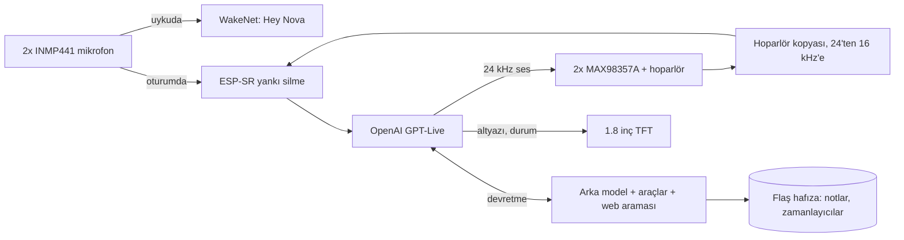

# Nova V2

[English](README.md) · **Türkçe**

Elle kıvrılmış bakır bir kafesin içinde yaşayan, kendi başına çalışan bir yapay zekâ ses asistanı. Tek bir ESP32-S3 var, arada bilgisayar yok: "Hey Nova" deyince uyanıyor, Wi-Fi üzerinden doğrudan OpenAI'ın gerçek zamanlı ses modeliyle konuşuyor, kendi sesini mikrofondan sildiği için sözünü kesebiliyorsun ve konuşmalar arasında bir şeyleri aklında tutuyor.


## Hikâye

Masamda duran bir yapay zekâ ajanı istiyordum. Fikir basitti, yapması hiç değildi.

Soldaki **V1 (Jarvis)**, 2026 yazında yapıldı: küçük bir bakır kafes, tek mikrofon, minik bir OLED ve tek hoparlör. ESP32 sadece sesi taşıyordu; düşünme işini laptopumda çalışan bir Python programı yapıyor, Gemini Live'a o bağlanıyordu. Çalıştı ama bir cihaz değil, bilgisayarın aksesuarıydı. Yolda bazı şeyleri de acı yoldan öğretti: parazitten ölen OLED'ler, gürültülü amfi beslemesi, seri dirençle susturulan hoparlör cızırtısı ve çıplak metal bir kafeste pilin neden ayrı tutulması gerektiği. Şimdi rafta, pili sökülü, emekli.

Sağdaki **Nova V2** bir yükseltme olarak başladı, bambaşka bir projeye dönüştü: yeni donanım, yeni mimari ve zincirin hiçbir yerinde bilgisayar yok.

## Öne çıkanlar

- **Kafesin kendisi toprak hattı.** 2 mm çıplak bakır telden elle kıvrılmış altıgen bir kafes; tamamı devrenin GND'si. Baskılı devre de kutu da yok: her parça doğrudan kafese tel tel lehimli.
- **Bilgisayar da ara sunucu da yok.** ESP32-S3, OpenAI GPT-Live'a (`gpt-live-1`) doğrudan şifreli WebSocket açıyor. Bu model aynı anda hem dinleyip hem konuşabiliyor.
- **Ses kodeği olmadan sözünü kesebiliyorsun.** Yankı silme çipin üstünde, hoparlöre giden sesin yazılımdaki kopyasıyla çalışıyor. Nova konuşurken araya girersen susuyor.
- **Uyandırma kelimesi cihazın içinde.** "Hey Nova"yı Espressif WakeNet yerelde dinliyor; ses ancak uyandıktan sonra dışarı çıkıyor.
- **Second brain içinde.** Her konuşmanın başında okuduğu kişisel bir profil ve kalıcı bir hafıza; yanında zamanlayıcı, alarm, ayar ve not araçları.
- **Boşken de iş görüyor.** Saatlik hava durumu, günde üç kez gündem özeti ve son konuşmadan kalıcı bilgileri ayıklayan otomatik bir tarama.
- **Ürün gibi.** 20 FPS'de çizilen kendi arayüzü, `http://nova.local` paneli, otomatik geri dönüşlü kablosuz güncelleme ve masaüstünde koşan testler.

## Nasıl çalışıyor



Uykudayken yalnızca uyandırma motoru dinliyor. "Hey Nova" denince motor bellekten kalkıyor, bulut oturumu açılıyor ve mikrofon sesi yankı silmeden geçip modele gidiyor. GPT-Live araçları kendisi çağırmıyor; arama ve cihaz işlerini bir arka modele devrediyor, o da firmware'in sunduğu araçları kullanıyor.

## Donanım

| Parça | Not |
|---|---|
| ESP32-S3 N16R8 | 16 MB flaş, 8 MB PSRAM |
| 2x INMP441 | Ortak I2S hattında (birinin L/R ayağı GND'de, diğerininki 3V3'te), kafesin ön alt köşelerinde havada asılı |
| 2x MAX98357A | I2S amfi, ikisi de aynı mono sesi çalıyor; GAIN ve SD boşta |
| 2x 5 cm 8 Ω 5 W hoparlör | Kafesin iki yan yüzünde |
| 1.8" ST7735 TFT | 160x128, SPI |
| 2x 18650 paralel | TP4056 USB-C şarj, MT3608 ile 5 V'a yükseltme |
| 47k/47k bölücü | Pil gerilimi ADC'de |

**Yapım notları**

- Bakır her lehimden önce kazınıyor. Mikrofonlara giden sinyal hatları ince emaye tel.
- Pilin eksi ucu kafesten ayrı. Kafes toprağa yükselticinin çıkışında (`VOUT-`) bağlanıyor.
- I2S hatlarında ESP32 tarafında seri dirençler var (V1'in hoparlör cızırtısından kalan ders).

**Pinler** (`firmware/nova_live/config.h`)

| İş | GPIO |
|---|---|
| Sağ amfi BCLK / LRC / DIN | 42 / 2 / 41 |
| Sol amfi BCLK / LRC / DIN | 10 / 11 / 9 |
| Mikrofon SCK / WS / SD | 12 / 13 / 14 |
| TFT BLK / CS / DC / RST / MOSI / SCK | 4 / 5 / 6 / 7 / 15 / 16 |
| Pil ADC | 3 |
| BOOT düğmesi / RGB LED | 0 / 48 |

Elle çizilmiş şema `docs/` klasöründe (tam güncel değil; esas kaynak `config.h`).

## Firmware

Güncel firmware `firmware/nova_live/` (v2.8.x), Arduino IDE ile derleniyor.

| Dosya | İşi |
|---|---|
| `nova_live.ino` | Wi-Fi, düğme, komutlar, arka plan görevleri |
| `link.cpp` | Konuşma akışı: uyku, bağlanma, dinleme, düşünme, konuşma |
| `proto.h`, `gptlive.cpp` | Sağlayıcı arayüzü ve GPT-Live protokolü |
| `wsclient.cpp` | Büyük mesajları PSRAM'de tutan WebSocket istemcisi |
| `audio.cpp`, `loudness.h`, `resample.h` | I2S, çalma, sınırlayıcı, örnekleme dönüşümü, yankı silme, mikrofon testleri |
| `wake.cpp`, `heynova_model.c` | "Hey Nova" (WakeNet10, model firmware'in içinde) |
| `araclar.cpp`, `hafiza.cpp` | Cihaz araçları; notlar ve zamanlayıcılar flaşta |
| `notcikar.cpp` | Oturum sonunda kalıcı bilgileri ayıklama |
| `hava.cpp`, `gundem.cpp`, `agistek.cpp` | Hava durumu, gündem özeti, küçük HTTPS istemcisi |
| `ekran.cpp`, `ui.cpp` | Ekran çizimi ve arayüz görevi |
| `netlog.cpp` | `nova.local` paneli, OTA, çökme raporu, güvenli kip |
| `kisilik.h` | Nova'nın karakteri (paylaşılıyor) |
| `kisisel.example.h` | Kendi profilin için şablon (`kisisel.h` repoya girmiyor) |

## Mühendislik notları

### Ses modelini seçmek

Karar vermeden önce üç canlı ses modeli ortak bir sağlayıcı arayüzü üzerinden aynı kartta yan yana denendi:

| | Gemini 3.8 Live | GPT Realtime 2.1 | GPT-Live 1 |
|---|---|---|---|
| İlk sese kadar | ~1,0–1,2 sn | ~1,2–3,5 sn | ~0,8–1,5 sn |
| Kısa Türkçe sözleri doğru yazıya dökme | sık hata | sık hata | evet |
| Söz sırası | sessizliğe bakarak | anlama bakarak (semantic VAD) | aynı anda dinleyip konuşuyor |

GPT-Live hızda, yazıya dökmede ve Türkçesinin doğallığında öne çıktı; aynı anda dinleyip konuşabilmesi de araya girmeye en uygun model olmasını sağladı. Diğer ikisinin sürücüleri aynı arayüzü uyguluyor ve `firmware/arsiv/saglayicilar/` altında duruyor.

### Ses kodeği olmadan yankı silme

Sesli asistan için yapılmış kartlarda genelde hoparlör sinyalini referans olarak geri veren bir ses kodeği olur. Nova'da iki ayrı I2S amfi var, o yüzden referans yazılımda üretiliyor:

1. Çalma görevi modelden gelen sesi yüksek geçiren süzgeçten, kazançtan ve tavanı −3 dBFS olan ileriye bakan bir sınırlayıcıdan geçiriyor.
2. Hoparlöre giden son ses 24 kHz'ten 16 kHz'e indirilip (96 katsayılı Kaiser FIR) PSRAM'de 4 saniyelik bir halkaya yazılıyor.
3. Bir ölçüm komutu 3 saniye beyaz gürültü çalıp hoparlörden mikrofona gecikmeyi çapraz ilintiyle buluyor. Bu kafeste **81,6 ms**.
4. Mikrofon sesi yankı silmeye girmeden önce 12 dB kısılıyor. Bu pay olmadan yüksek seste örneklerin %5,7'si kırpılıyordu ve kırpılmış yankı silinemiyor. Payla birlikte kırpılma %0'a indi.
5. ESP-SR'nin frekans tabanlı AEC'si PSRAM'de çalışıyor (32 ms'lik çerçeve başına ~9,7 ms). Arkasındaki kapı yalnızca ölçülen artık yankının belirgin üstündeki sesi geçiriyor.

Bastırma beyaz gürültü ölçümünde 31–40 dB, %80 seste gerçek konuşmada genelde 12–17 dB. Pratikte araya girmek için yetiyor.

### TLS, uyandırma ve AEC'yi iç RAM'e sığdırmak

Bu çekirdekte TLS (mbedTLS) yalnızca iç RAM'den yer alıyor; WakeNet'in ve AEC'nin bir kısmı da öyle. İlk sürümlerde en büyük boş iç RAM bloğu 30 KB'a inince TLS el sıkışması "Memory allocation failed" diye düşüyordu.

- Büyük tamponların hepsi (ses, WebSocket, arayüz, yazılar) ve mikrofon kuyruğu PSRAM'e taşındı; yaklaşık 66 KB iç RAM boşaldı.
- Uyandırma motoru yalnızca Nova uykudayken var. Uyanınca ve arka planda bir HTTPS isteğinden önce kaldırılıyor; yeri TLS'e ve AEC'ye kalıyor.
- 476 KB'lık uyandırma modeli firmware'in içine gömülü ve bellekten yükleniyor; ayrı bir model bölümü gerekmiyor. Bölüm tablosu her yazılım yuvasına 6 MB veriyor.

### Hafıza ve second brain

- `kisilik.h` Nova'nın kim olduğunu, `kisisel.h` (repoda yok) sahibini anlatıyor. İkisi de her oturumun sistem talimatına tarih, hava, gündem, kurulu zamanlayıcılar ve kayıtlı notlarla birlikte giriyor.
- Notlar araçlarla (`remember`, `forget`) kaydediliyor. Üç kural var: istenince kaydet, kalıcı ve işe yarar bir şey öğrenince kendin kaydet, hassas bir şeyse önce sor.
- Ses modelleri bazen aracı hiç çağırmadan "not aldım" diyebiliyor. Bu yüzden oturum kapandıktan 2 saniye sonra cihaz konuşma dökümünü katı bir JSON şemasıyla Responses API'ye gönderiyor ve dönen kalıcı bilgileri hafızaya işliyor.
- Kayıt, ham flaş bölümünde sırayla yazılan iki 32 KB'lık yuvada, sıra numarası ve CRC ile tutuluyor. Flaşa yazmak önbelleği durdurduğu için yazma yalnızca 3 saniyelik boşluktan sonra yapılıyor, konuşma sırasında asla.

### Mikrofon arızasının peşinde

Her şeyi canlı bir toprak kafesine elle lehimleyince donanım arızaları yazılım hatası gibi görünüyor.

- Açılış testi, mikrofonun WS ve SCK tellerinin lehim notlarının tersine bağlandığını buldu.
- Sonra iki mikrofon birden rastgele kesilmeye başladı; çoğu zaman klavyede yazarken ya da hoparlör çalarken. Multimetrede besleme, toprak ve saat gerilimleri sorunsuz görünüyordu.
- Yazılımı donanımdan ayırmak için bir iç döngü testi eklendi: ESP32 kendi WS saatini GPIO matrisi üzerinden veri girişine veriyor. Kesintiler sırasında bile her seferinde geçti; yani sorun yazılımda değildi.
- Canlı izleme (`c`) karttaki LED'i her mikrofon için yeşil/sarı/kırmızı yakıyor. Bu açıkken lehimler oynatılınca durum değişti: soğuk lehim. Yenilendikten sonra 600 kontrolün 600'ü temiz.

### Arayüz, panel ve güncelleme

- Ekran çizimi PSRAM'deki 160x128'lik bir tampona yumuşak kenarlı halkalar ve Türkçe yazı tipleriyle yapılıyor; SPI'dan yalnızca değişen kısımlar gidiyor. Oturumda yaklaşık 20 FPS.
- `http://nova.local` canlı kaydı, cihaz durumunu, notları ve zamanlayıcıları gösteriyor; yazılım yüklemeyi de kabul ediyor.
- Yeni yazılım Wi-Fi'de 20 saniye sorunsuz çalışana kadar "deneme"de kalıyor; ondan önce çökerse önyükleyici eskisine dönüyor. Üst üste üç çökmede yalnızca Wi-Fi, panel ve OTA ile açılan güvenli kip devreye giriyor. Son ~2 KB kayıt yeniden başlatmada kaybolmuyor.

## Testler

Bağlantı mantığı, araçlar, hafıza, yankı hesapları ve ekran çizimi Linux'ta (ya da WSL'de), süreç içinde çalışan sahte bir GPT-Live sunucusuna karşı derlenip koşuyor:

```bash
cd firmware/tests/nova_live_masaustu
./build.sh ../../nova_live
./t_wake    # oturum akışı: uyanma, konuşma, araya girme, veda, araçlar
./t_arac    # hafıza, zamanlayıcılar, araçlar, hava ve gündem ayrıştırma
./t_echo    # gecikme arama, örnekleme dönüşümü, kapı
./t_ekran   # ekran çizimi, AddressSanitizer ile
```

Hepsi `SONUC: GECTI` ile bitmeli. Her değişiklikte kod bilerek bozulup testin yakaladığı da kontrol ediliyor.

## Kurulum

Arduino IDE, esp32 çekirdeği **3.3.12 ya da yenisi**.

| Tools ayarı | Değer |
|---|---|
| Board | ESP32S3 Dev Module |
| PSRAM | OPI PSRAM |
| Flash Size | 16MB |
| Partition Scheme | Custom (klasördeki `partitions.csv` kullanılır) |
| Flash Mode | QIO 80MHz |

Kütüphaneler: Adafruit GFX, Adafruit ST7735 and ST7789. ArduinoJson klasörün içinde geliyor. PSRAM ya da bölüm ayarı yanlışsa derleme açık bir hatayla duruyor.

1. `secrets.example.h`'yi `secrets.h` olarak kopyala; Wi-Fi, `OPENAI_API_KEY` ve `OTA_PASS` (en az 8 karakter) bilgilerini doldur.
2. İstersen `kisisel.example.h`'yi `kisisel.h` olarak kopyalayıp kendini anlat.
3. İlk yüklemeyi USB'den yap (bölüm tablosu yalnızca USB yüklemesiyle değişiyor). Sonrasında `http://nova.local`'dan ya da IDE'nin ağ portundan güncelleyebilirsin.
4. Bir kez `a` ile yankı gecikmesini ölç, sonra `e` ile araya girmeyi aç.

## Komutlar

Serial (115200) ya da `nova.local`'daki yazı kutusu:

| Tuş | İş |
|---|---|
| `w` / `x` / `b` | uyandır / oturumu kapat / BOOT düğmesi gibi davran |
| `n` | uyandırma: kapalı, normal, hassas, çok hassas |
| `a` / `e` | yankı ölçümü / araya girme aç-kapa |
| `o` / `O` | sonraki / önceki ses |
| `H` | notlar ve zamanlayıcılar (panelde `/unut 3`, `/iptal 2`) |
| `u` | kullanım ve ücret sayacı |
| `+` / `-` | ses |
| `t` `l` `r` / `g` | iki, sol, sağ amfi test sesi / gürlük testi |
| `m` / `c` | mikrofon testi / canlı mikrofon izleme |
| `R` / `?` | yeniden başlat / yardım |

"Görüşürüz" ya da "oturumu kapat" demek oturumu bitiriyor; Nova'nın kısa bir vedası da öyle.

## Bilinen sınırlar

- GPT-Live bağlı kalınan dakika başına ücretleniyor (dakikası yaklaşık 0,05 $, sessizlik dahil). Bunu düşük tutmak için oturum birkaç saniyelik sessizlikten sonra kapanıyor.
- Araya girmek, sunucunun sözünü yazıya dökmesini beklediği için Nova kısa bir gecikmeyle susuyor.
- "Hey Nova" modeli Espressif'in yapay seslerle eğitilmiş İngilizce modeli. Çalışıyor ama biraz net söylemek gerekiyor.
- Çok yüksek seste amfi ve hoparlör doğrusallıktan çıktığı için yankı bastırma düşüyor.
- Kod ve yorumlar Türkçe.

## Klasörler

| Yol | İçerik |
|---|---|
| `firmware/nova_live/` | Güncel firmware |
| `firmware/arsiv/saglayicilar/` | Gemini Live ve GPT Realtime sürücüleri, son çok sağlayıcılı sürüm |
| `firmware/tests/nova_live_masaustu/` | Masaüstü testleri |
| `firmware/nova_tools/` | Panel kaynağı ve yazı tipi üretici |
| `docs/` | Fotoğraflar ve şema |

## Teşekkürler

- WakeNet, AEC ve "Hey Nova" modeli için [Espressif ESP-SR](https://github.com/espressif/esp-sr)
- ESP32-S3'te kodeksiz yankı silmenin mümkün olduğunu gösteren [RIO](https://github.com/mk14ray/RIO-XIAO-ESP32-S3-Gemini-Live-Voice-Assistant)
- Adafruit GFX ve ST7735 kütüphaneleri, ArduinoJson, Chakra Petch (OFL), Open-Meteo

## Lisans

Belirlenecek
