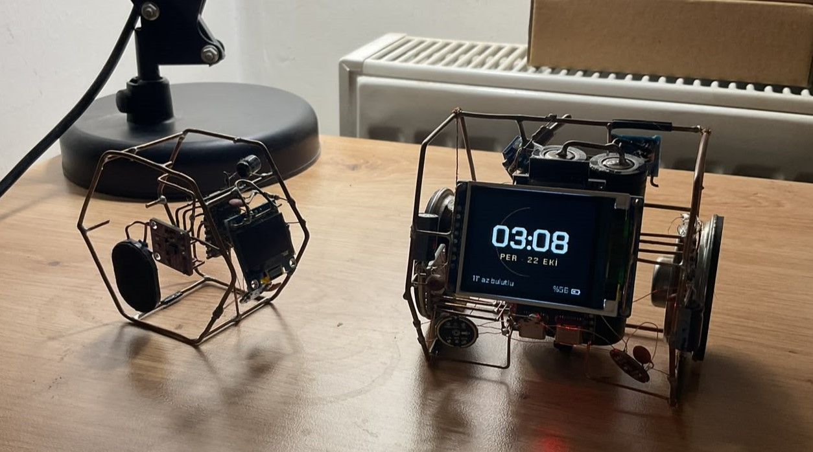
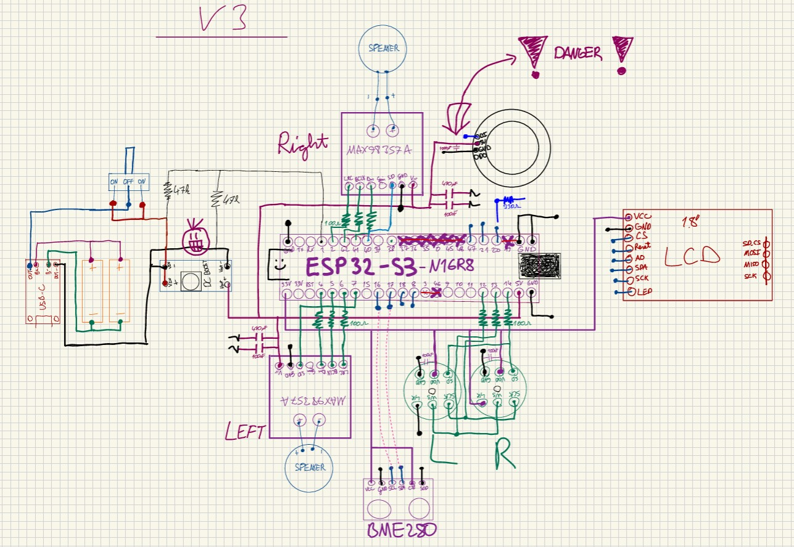
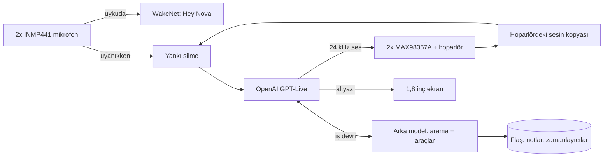

# Nova V2

[English](README.md) · **Türkçe**

**Masamdaki bakır kafeste yaşayan bir ses asistanı.** Tek bir ESP32-S3; laptop yok, sunucu yok, baskılı devre yok. "Hey Nova" diyorsun, uyanıyor, OpenAI'ın gerçek zamanlı ses modeliyle konuşuyor. Lafını istediğin an kesebiliyorsun, ertesi gün de seni hatırlıyor.





## Neler yapıyor

- 🎙️ **"Hey Nova" deyince uyanıyor.** Kelimeyi çipin kendisi tanıyor; uyanmadan cihazdan dışarıya tek bir ses bile çıkmıyor.
- ⚡ **Gerçek zamanlı konuşuyor.** ESP32-S3, OpenAI GPT-Live'a doğrudan WebSocket açıyor. Bu model aynı anda hem dinliyor hem konuşuyor.
- ✋ **Sözünü kesebiliyorsun.** Kendi sesini yazılımla siliyor; sen araya girince susuyor. Bunun için ses kodeğine de ihtiyaç duymuyor.
- 🧠 **Hatırlıyor.** Notlar, alışkanlıklar, yakınların, süren işlerin. Her konuşmanın başında okuduğu küçük bir ikinci beyni var.
- 🛠️ **İş görüyor.** Web araması, zamanlayıcı, alarm, ses, parlaklık, ayarlar; hepsi sesle.
- ☀️ **Gündemi takip ediyor.** Saatte bir hava durumunu, günde üç kez de haberleri çekiyor; sorduğunda zaten haberi oluyor.
- 🟠 **Bir yüzü var.** 1,8 inçlik ekranda 20 FPS çalışan bakır temalı bir arayüz, bir de `http://nova.local`'da canlı kayıtları gösteren, kablosuz güncelleme yapılabilen bir panel.

## Nasıl başladı

Masamda duran bir yapay zekâ istedim. Basit görünüyordu, hiç de öyle çıkmadı.

Soldaki **V1 (Jarvis)**'i 2026 yazında yaptım: küçük bir bakır kafes, tek mikrofon, minicik bir OLED ve tek hoparlör. ESP32 sadece sesi taşıyordu, asıl düşünen laptopumdaki bir Python betiğiydi. Çalışıyordu ama bir cihaz değil, laptopun aksesuarıydı. Bana birkaç şeyi de zor yoldan öğretti: OLED'ler parazitten ölüyor, amfi beslemesi uğulduyor, hoparlördeki cızırtı seri dirençle geçiyor ve pil çıplak metal kafese asla değmemeli. Şimdi rafta, pili sökülmüş halde emekliliğin tadını çıkarıyor.

Sağdaki **Nova V2** aslında bir yükseltme olacaktı. Sonunda bambaşka bir projeye dönüştü: yeni donanım, yeni mimari ve zincirin hiçbir halkasında bilgisayar yok.

Gövde 2 mm'lik çıplak bakır tel; elle büküp altıgen bir kafes yaptım ve **kafesin tamamı devrenin toprağı**. Ne baskılı devre var ne kutu, her parça doğrudan kafese lehimli. Bir yerden sonra devre olmaktan çıktı, küçük bir cyberpunk heykele dönüştü.

## Nasıl çalışıyor



Nova uyurken sadece uyandırma motoru dinliyor. "Hey Nova" deyince motor kenara çekiliyor, bulutla oturum açılıyor ve mikrofondaki ses yankı silmeden geçip modele gidiyor. GPT-Live araçları kendisi çağırmıyor: arama ya da zamanlayıcı istediğinde işi bir arka modele devrediyor, o da firmware'in sunduğu araçları kullanıyor.

## İşin zor kısımları

### Kodeksiz yankı silme

Sözünü kesebilmen için Nova'nın seni kendi sesinin üstünden duyması gerekiyor. Sesli asistan kartlarında bunun için hoparlör sinyalini geri veren bir ses kodeği olur. Nova'da sadece iki ayrı I2S amfi var, o yüzden bu referansı yazılımda kendim üretiyorum:

1. Nova'nın söylediği her şey yüksek geçiren bir süzgeçten, kazanç katından ve ileriye bakan bir sınırlayıcıdan (tavan −3 dBFS) geçiyor.
2. Bu son sinyal 24 kHz'ten 16 kHz'e indirilip PSRAM'deki 4 saniyelik bir halkada tutuluyor.
3. Bir ölçüm komutu 3 saniye beyaz gürültü çalıp hoparlörle mikrofon arasındaki gecikmeyi çapraz ilintiyle buluyor. Bu kafeste **81,6 ms**.
4. Mikrofon yankı silmeye girmeden 12 dB kısılıyor. Bu pay olmadan yüksek seste örneklerin %5,7'si kırpılıyordu, kırpılmış yankı da silinemiyor. Payla birlikte kırpılma sıfıra indi.
5. Espressif'in yankı silmesi PSRAM'de çalışıyor (32 ms'lik çerçeve başına ~9,7 ms). Arkasındaki akıllı kapı sadece artık yankının belirgin üstündeki sesi geçiriyor. Kapı açıldığında o ana kadar tuttuğu birkaç yüz milisaniyeyi de yolluyor, böylece cümlenin başı kaybolmuyor.

Beyaz gürültüde yankının 31–40 dB'ini, %80 seste gerçek konuşmada genelde 12–17 dB'ini siliyor. Normal sesle araya girmeye yetiyor.

### TLS'i, uyandırmayı ve yankı silmeyi iç RAM'e sığdırmak

Bu çekirdekte TLS sadece iç RAM'den yer alabiliyor; uyandırma motorunun ve yankı silmenin bir kısmı da öyle. İlk sürümler, en büyük boş blok 30 KB'a indiği an TLS el sıkışmasında "Memory allocation failed" deyip düşüyordu.

- Büyük tamponların hepsini (ses, WebSocket, arayüz, yazılar) ve mikrofon kuyruğunu PSRAM'e taşıdım; iç RAM'de yaklaşık 66 KB yer açıldı.
- Uyandırma motoru sadece Nova uyurken var. Uyanınca ve arka plandaki her HTTPS isteğinden önce kaldırılıyor, yeri TLS'e ve yankı silmeye kalıyor.
- 476 KB'lık uyandırma modeli firmware'in içine gömülü ve bellekten yükleniyor; ayrı bir model bölümüne gerek yok.

### Sesi seçmek

Modeli kâğıt üstünde seçmek istemedim. Üç canlı ses modelini aynı kartta, aynı arayüzün arkasında yan yana denedim:

| | Gemini 3.8 Live | GPT Realtime 2.1 | GPT-Live 1 |
|---|---|---|---|
| İlk sese kadar | ~1,0–1,2 sn | ~1,2–3,5 sn | ~0,8–1,5 sn |
| Kısa Türkçe sözleri doğru anlama | sık hata | sık hata | evet |
| Söz sırası | sessizliği bekliyor | anlama bakıyor | aynı anda dinleyip konuşuyor |

GPT-Live hızda, anlamada ve Türkçesinin doğallığında açık ara öndeydi. Aynı anda dinleyip konuşabildiği için araya girmeye de en uygun model o.

### Unutmayan bir ikinci beyin

- `kisilik.h` Nova'nın kim olduğunu, `kisisel.h` (repoya hiç girmiyor) sahibinin kim olduğunu anlatıyor. İkisi de her oturumun başında tarih, hava, gündem, kurulu alarmlar ve kayıtlı notlarla birlikte modele gidiyor.
- Not alırken üç kurala uyuyor: istenince kaydet, kalıcı ve işe yarar bir şey öğrenince kendin kaydet, hassas bir şeyse önce sor.
- Ses modelleri bazen aracı hiç çağırmadan "not aldım" diyebiliyor. Bu yüzden oturum kapandıktan iki saniye sonra cihaz konuşmanın dökümünü katı bir JSON şemasıyla Responses API'ye yolluyor ve dönen kalıcı bilgileri kendisi kaydediyor.
- Notlar flaşta sırayla yazılan iki 32 KB'lık yuvada, sıra numarası ve CRC ile duruyor. Flaşa yazmak önbelleği durdurduğu için konuşma sırasında asla yazılmıyor.

### Yazılım hatası kılığındaki soğuk lehim

Her şeyi canlı bir toprak kafesine elle lehimleyince donanım arızaları yazılım hatası gibi görünmeye başlıyor.

- Açılış testi, mikrofonun WS ve SCK tellerinin benim kendi lehim notlarımın tersine bağlandığını yakaladı.
- Sonra iki mikrofon birden rastgele kesilmeye başladı, çoğunlukla ben klavyede yazarken ya da hoparlör çalarken. Multimetrede besleme, toprak, saat; hepsi normal görünüyordu.
- Yazılımı donanımdan ayırmak için bir döngü testi ekledim: ESP32 kendi WS saatini GPIO matrisi üzerinden veri girişine bağlıyor. Kesintilerin ortasında bile her seferinde geçti. Yani suçlu yazılım değildi.
- Canlı izleme (`c`) karttaki LED'i her mikrofon için yeşil, sarı ya da kırmızı yakıyor. O açıkken lehimleri oynattım, renk değişti: soğuk lehim. Yeniden lehimledikten sonra 600 kontrolün 600'ü temiz geldi.

### Ürün gibi

- Ekran, PSRAM'deki 160x128'lik bir tampona yumuşak kenarlı halkalar ve Türkçe karakterli yazı tipleriyle çiziliyor; SPI'dan sadece değişen kısımlar gidiyor. Konuşurken yaklaşık 20 FPS.
- Yeni yazılım Wi-Fi'da 20 saniye sorunsuz çalışana kadar "deneme"de kalıyor; ondan önce çökerse önyükleyici kendiliğinden eskisine dönüyor. Üst üste üç çökmede sadece Wi-Fi, panel ve kablosuz güncellemeyle açılan güvenli kipe geçiyor.
- Kaydın son ~2 KB'ı yeniden başlatmada silinmiyor; çöktüğünde arkasında mutlaka bir not bırakıyor.

## Donanım

| Parça | Not |
|---|---|
| ESP32-S3 N16R8 | 16 MB flaş, 8 MB PSRAM |
| 2x INMP441 | Ortak I2S hattında (birinin L/R ayağı GND'de, diğerininki 3V3'te), kafesin ön alt köşelerinden sarkıyor |
| 2x MAX98357A | Aynı mono sesi çalan I2S amfiler; GAIN ve SD boşta |
| 2x 5 cm 8 Ω 5 W hoparlör | Kafesin iki yanında |
| 1,8" ST7735 TFT | 160x128, SPI |
| 2x 18650 paralel | TP4056 USB-C şarj, MT3608 ile 5 V'a yükseltme |
| 47k/47k bölücü | Pil gerilimini ADC'ye veriyor |

Yaparken dikkat ettiklerim:

- Her lehimden önce bakırı kazıyıp temizliyorum. Mikrofonlara giden sinyal hatları ince emaye tel.
- Pilin eksisi kafese hiç değmiyor. Kafes toprağa yükselticinin çıkışında (`VOUT-`) bağlanıyor.
- I2S hatlarında ESP32 tarafında seri direnç var; V1'in cızırdayan hoparlöründen kalma bir ders.

<details>
<summary>Pinler</summary>

| İş | GPIO |
|---|---|
| Sağ amfi BCLK / LRC / DIN | 42 / 2 / 41 |
| Sol amfi BCLK / LRC / DIN | 10 / 11 / 9 |
| Mikrofon SCK / WS / SD | 12 / 13 / 14 |
| TFT BLK / CS / DC / RST / MOSI / SCK | 4 / 5 / 6 / 7 / 15 / 16 |
| Pil ADC | 3 |
| BOOT düğmesi / RGB LED | 0 / 48 |

Şema elle çizildi ve tam güncel değil. Emin olamadığın yerde `firmware/nova_live/config.h`'ye bak.

</details>

## Kendin yap

Arduino IDE, esp32 çekirdeği **3.3.12 ya da yenisi**.

| Tools ayarı | Değer |
|---|---|
| Board | ESP32S3 Dev Module |
| PSRAM | OPI PSRAM |
| Flash Size | 16MB |
| Partition Scheme | Custom (klasördeki `partitions.csv` kullanılır) |
| Flash Mode | QIO 80MHz |

Kütüphaneler: Adafruit GFX ile Adafruit ST7735 and ST7789. ArduinoJson zaten klasörde.

1. `secrets.example.h`'yi `secrets.h` adıyla kopyala; Wi-Fi bilgilerini, `OPENAI_API_KEY`'i ve en az 8 karakterlik bir `OTA_PASS` yaz.
2. `kisilik.h`'de Nova'ya bir karakter ver, orayı bilerek boş bıraktım. Seni tanımasını istiyorsan `kisisel.example.h`'yi `kisisel.h` olarak kopyalayıp doldur.
3. İlk yüklemeyi USB'den yap. Sonrasında `http://nova.local`'dan ya da IDE'nin ağ portundan güncelleyebilirsin.
4. Bir kez `a` ile yankı gecikmesini ölç, sonra `e` ile araya girmeyi aç.

Ekran varsayılan olarak İngilizce. Türkçe için `config.h`'de `UI_ENGLISH`'i `0` yap.

<details>
<summary>Komutlar (115200'de Serial ya da nova.local'daki yazı kutusu)</summary>

| Tuş | İş |
|---|---|
| `w` / `x` / `b` | uyandır / oturumu kapat / BOOT düğmesiyle aynı |
| `n` | uyandırma: kapalı, normal, hassas, çok hassas |
| `a` / `e` | yankı ölçümü / araya girme aç-kapa |
| `o` / `O` | sonraki / önceki ses |
| `H` | notları ve alarmları listele |
| `u` | kullanım ve ücret sayacı |
| `+` / `-` | ses |
| `t` `l` `r` / `g` | iki, sol, sağ amfiden test sesi / gürlük testi |
| `m` / `c` | mikrofon testi / canlı mikrofon izleme |
| `R` / `?` | yeniden başlat / yardım |

"Görüşürüz" ya da "bye bye" demek oturumu kapatıyor.

</details>

<details>
<summary>Firmware'de ne var</summary>

| Dosya | Ne yapıyor |
|---|---|
| `nova_live.ino` | Wi-Fi, düğme, komutlar, arka plan görevleri |
| `link.cpp` | Konuşmanın akışı: uyku, bağlanma, dinleme, düşünme, konuşma |
| `proto.h`, `gptlive.cpp` | Sağlayıcı arayüzü ve GPT-Live protokolü |
| `wsclient.cpp` | Büyük tamponları PSRAM'de tutan WebSocket istemcisi |
| `audio.cpp`, `echo_math.h`, `loudness.h`, `resample.h` | I2S, çalma, sınırlayıcı, örnekleme dönüşümü, yankı silme, mikrofon testleri |
| `wake.cpp`, `heynova_model.c` | "Hey Nova" (WakeNet10, model firmware'in içinde) |
| `araclar.cpp`, `hafiza.cpp`, `notcikar.cpp` | Cihaz araçları, hafıza, oturum sonunda not çıkarma |
| `hava.cpp`, `gundem.cpp`, `agistek.cpp` | Hava durumu, gündem özeti, küçük bir HTTPS istemcisi |
| `ekran.cpp`, `ui.cpp` | Ekran çizimi ve arayüz görevi |
| `netlog.cpp` | `nova.local` paneli, kablosuz güncelleme, çökme raporu, güvenli kip |

</details>

## Testler

Konuşma akışı, araçlar, hafıza, yankı hesapları ve ekran çizimi Linux'ta (ya da WSL'de) sahte bir GPT-Live sunucusuna karşı derlenip çalışıyor:

```bash
cd firmware/tests/nova_live_masaustu
bash build.sh ../../nova_live
./t_wake && ./t_arac && ./t_echo && ./t_ekran
```

Hepsi `SONUC: GECTI` ile bitmeli. Her değişiklikte kodu bilerek bozup testin bunu yakaladığından da emin oluyorum.

## Bilinen sınırlar

- GPT-Live bağlı kalınan dakika başına ücretleniyor (dakikası yaklaşık 0,05 $, sessizlik dahil). Bu yüzden oturum kısa bir sessizlikten sonra kendiliğinden kapanıyor.
- Araya girdiğinde sunucunun sözünü yazıya dökmesi gerekiyor, Nova o yüzden kısa bir gecikmeyle susuyor.
- "Hey Nova" modeli Espressif'in yapay seslerle eğitilmiş İngilizce modeli. Çalışıyor ama net söylemek lazım.
- Çok yüksek seste amfiler ve hoparlörler doğrusallıktan çıkıyor, yankı silme zayıflıyor.
- Koddaki yorumlar ve kayıtlar Türkçe.

## Teşekkürler

- WakeNet, yankı silme ve "Hey Nova" modeli için [Espressif ESP-SR](https://github.com/espressif/esp-sr)
- ESP32-S3'te kodeksiz yankı silmenin yapılabileceğini bana gösteren [RIO](https://github.com/mk14ray/RIO-XIAO-ESP32-S3-Gemini-Live-Voice-Assistant)
- Adafruit GFX ve ST7735 kütüphaneleri, ArduinoJson, Chakra Petch yazı tipi (OFL), Open-Meteo

## Lisans

MIT, ayrıntısı [LICENSE](LICENSE) dosyasında. Başkalarına ait parçalar kendi lisanslarıyla geliyor.
